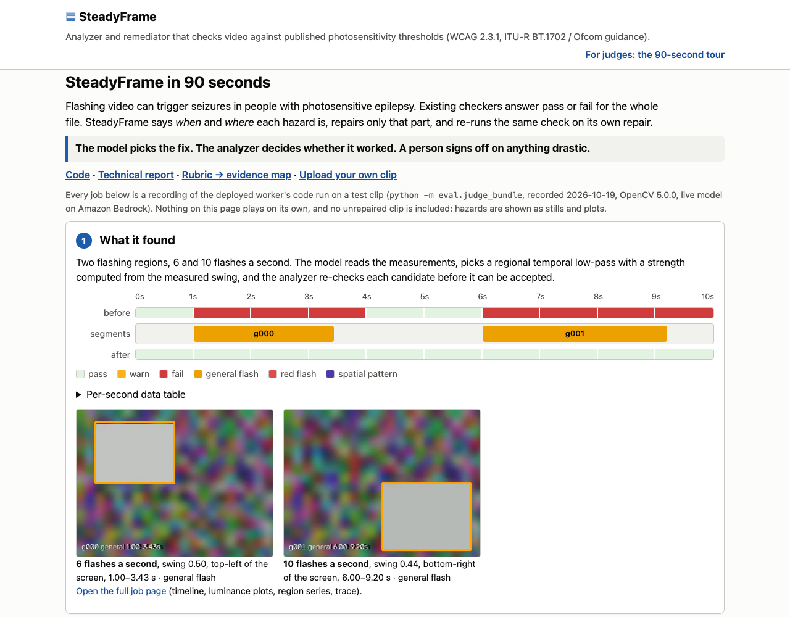
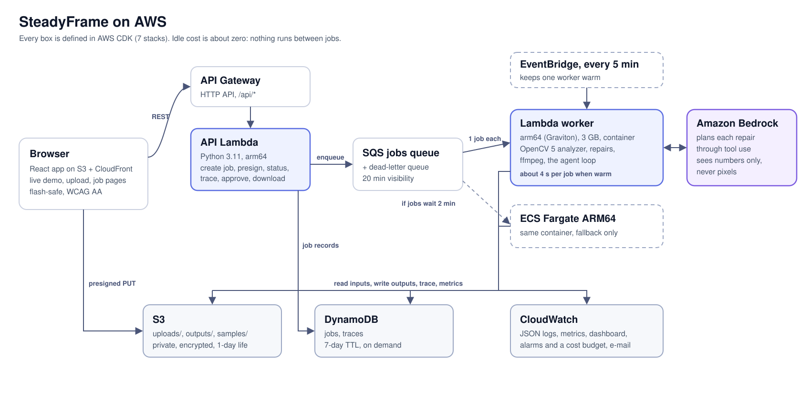
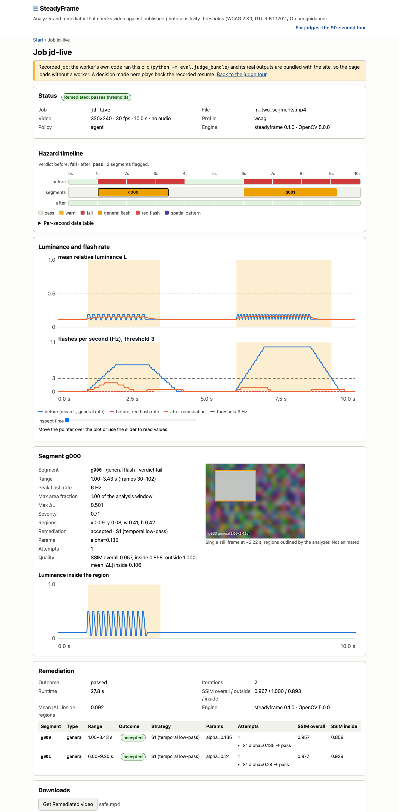
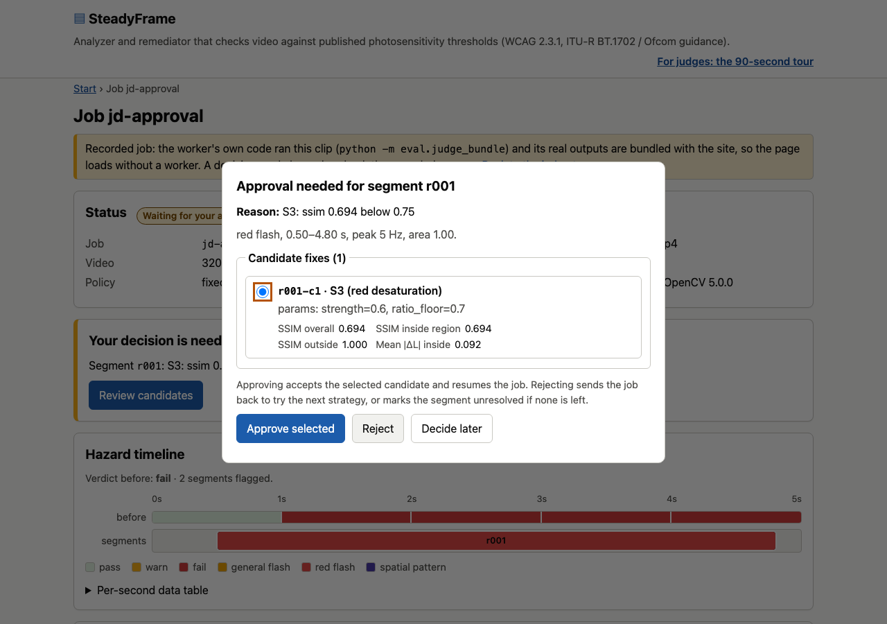
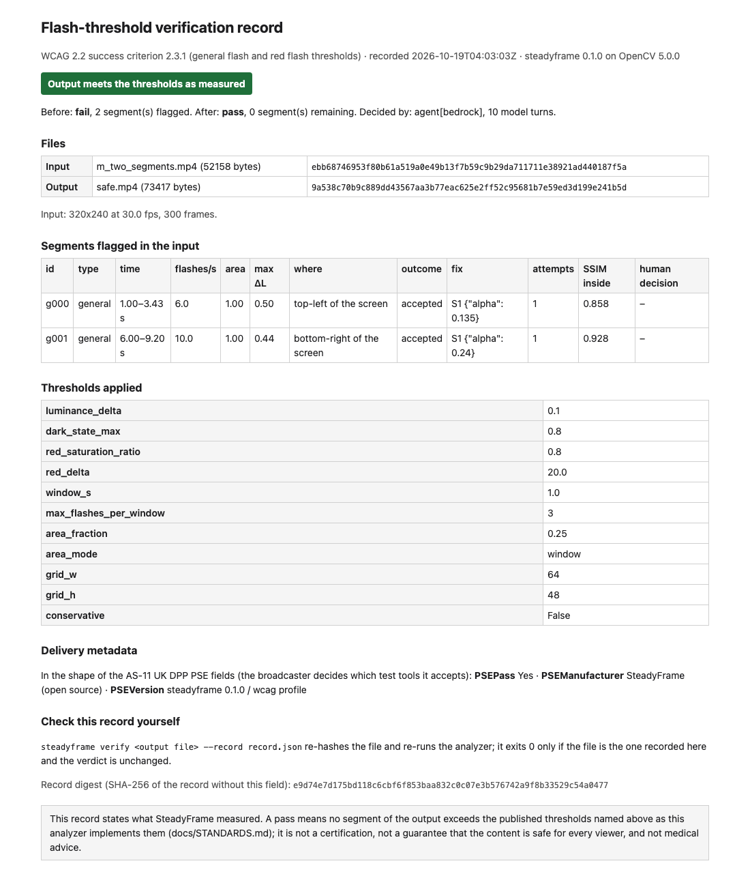

# SteadyFrame

**Finds the flashing in a video that can trigger seizures, says exactly when and where it is,
repairs only that part, and re-checks its own repair.** OpenCV 5 analysis, an agent on Amazon
Bedrock that plans the repair from the measurements, and a person in the loop for anything
drastic. Built for the OpenCV AI Competition 2026 (powered by AWS). Solo entry.

> The model picks the fix. The analyzer decides whether it worked. A person signs off on
> anything drastic.

| | |
|---|---|
| **90-second tour (no install, no upload, no waiting)** | https://d25yofo4x3sac8.cloudfront.net/judge |
| Live app (upload a clip or run a sample) | https://d25yofo4x3sac8.cloudfront.net |
| Rubric → evidence map | [`docs/JUDGES.md`](docs/JUDGES.md) |
| Technical report | [`docs/report/REPORT.md`](docs/report/REPORT.md) |
| Video | on the Devpost page |



**Not a medical device.** A pass means the published thresholds were met as implemented here
(`docs/STANDARDS.md`); it is not a certification. See `docs/RESPONSIBLE_USE.md`.

## Why

Flashing images can trigger seizures in people with photosensitive epilepsy, a few per cent of
the roughly 50 million people with epilepsy, most often first seen between ages 7 and 19. One
1997 cartoon broadcast in Japan sent 685 people to hospital. Strobing GIFs have been sent to
people with epilepsy on purpose, and the UK made that a crime in 2024. UK broadcast delivery
metadata (AS-11 UK DPP) has a mandatory photosensitivity field on every programme: pass, fail
or not tested.

The checkers that exist answer pass or fail for the whole file. The broadcast standard (Harding
FPA) is commercial; the free one (PEAT) may not be used on commercial broadcast, film or game
content; EA's open-source IRIS reports frames but not where on screen, and nothing repairs the
problem. A creator who fails learns nothing actionable; a viewer can't tell which seconds to skip.

## What it does

1. **Finds** every hazard against WCAG 2.2 SC 2.3.1 (or ITU-R BT.1702 / Ofcom): flash rate,
   luminance swing, area, red flash, and the region on screen, per segment.
2. **Repairs** each segment with the least invasive of six strategies, from a regional temporal
   low-pass in linear light to a frame hold, choosing the strength from the measured swing.
3. **Verifies** every candidate by re-running the same analyzer, escalates when it still fails,
   pauses for a person when a repair changes the picture too much, and re-verifies the whole
   file at the end.
4. **Hands over** the repaired video, a **verification record** (file hashes, thresholds, every
   segment and fix, any human decision, AS-11 UK DPP PSE fields; anyone can re-check it with
   `steadyframe verify`), and a **viewer warning track** (WebVTT) for the original.

## Run it in three commands (no credentials, no cloud account)

```bash
git clone https://github.com/SrijaVuppula/SteadyFrame.git && cd SteadyFrame
make install     # Python 3.11 venv with the pinned deps (requirements.lock), OpenCV 5 asserted at import
make demo        # renders 3 sample clips, analyzes, fixes, verifies; results in demo/ within seconds
```

Open `demo/<clip>/record.html`, `before_after.png` and `hazards.vtt`. The rendered input clips
flash by design: open the plots and records, not the inputs.

The web app, API and worker locally, still without credentials: `docker compose up --build`,
then http://localhost:8080 (the tour is at `/judge`).

Command line:

```bash
steadyframe analyze in.mp4 --json out.json --plot out.png --vtt hazards.vtt   # exit 2 on fail
steadyframe fix in.mp4 --policy fixed -o safe.mp4 --report report.json --record record.json
steadyframe fix in.mp4 --policy agent -o safe.mp4      # Bedrock; needs STEADYFRAME_BEDROCK_MODEL_ID
steadyframe fix in.mp4 --policy heuristic -o safe.mp4  # same loop, deterministic stand-in, offline
steadyframe verify safe.mp4 --record record.json       # re-hash + re-analyze; exit 4 if it doesn't hold
```

## How it works



1. **Analyze** (`steadyframe/analyzer.py`): per frame, `cv2.LUT` sRGB-to-linear, `INTER_AREA`
   resize to a 64x48 grid (exact for luminance, 12x faster than per-pixel maps),
   `cv2.transform` for relative luminance, a vectorised per-cell transition tracker
   (accumulated change between local extrema, 0.10 threshold, darker state below 0.80),
   trailing one-second windows by timestamp, the 25%-of-any-10-degree-window area rule with
   `cv2.boxFilter`, regions from `cv2.connectedComponentsWithStats`.
2. **Remediate** (`steadyframe/remediate/`): S1 regional temporal low-pass
   (`cv2.accumulateWeighted` in linear light), S2 luminance-swing compression, S3 red
   desaturation, S4 the same globally, S5 frame hold, S6 warning card. Quality: SSIM
   (`cv2.GaussianBlur`), PSNR, luminance change, temporal smoothness. Audio is remuxed and frame
   timing never changes.
3. **Loop** (`steadyframe/agent/`): a model on Amazon Bedrock (Converse API tool use) or a
   deterministic policy calls `analyze_video`, `get_segment_detail`, `apply_remediation`,
   `verify_candidate`, `request_human_approval`, `accept_candidate`, `finalize`. The model
   never sees pixels, file names or metadata, only analyzer numbers. The tools refuse anything
   unverified, failing or unapproved, every failure falls back to the fixed policy, and every
   call goes to the trace. Details: `docs/AGENT.md`, diagram: `docs/diagrams/agent_workflow.svg`.
4. **Deliver** (`service/`, `infra/`): S3 + CloudFront, API Gateway + Lambda, SQS, an ECS worker
   on Graviton (Fargate ARM64 by default, or Graviton4 with the COOL OpenCV build:
   `-c worker_engine=cool`), DynamoDB, CloudWatch, all in CDK. Scales to zero when idle.

## Results (reproduced by `make eval`; external clips need `make real` first)

| | |
|---|---|
| Detection: clip verdicts, boundary cases, per-second F1 | 44/44, 17/17, 1.000 |
| Robustness: H.264 CRF 28/35 variants keeping their verdict | 16/16 |
| Remediation (fixed policy): whole-file re-verification pass rate | 25/25, 1.1 iterations per segment |
| Agent (heuristic stand-in) vs fixed | same pass rate, 1.0 iterations per segment, higher SSIM inside regions |
| Agent (live Bedrock model) vs fixed | 25/25, 1.04 iterations per segment, SSIM inside regions 0.882 vs 0.861, 3.04 USD for the suite |
| External clips: EA IRIS test videos, Apple's flashing sample, 9 min of camera footage | 18/18 verdicts, IRIS's own verdict on 8/8, 0/551 control seconds flagged, 3/3 hazards fixed |
| Adversarial planner (accept unverified, skip approval, finish early, forged ids, injected metadata, ...) | 10/10 attacks held, 0 false passes |
| Analyzer throughput, 720p, 4-vCPU x86, stock wheel | ~600 fps analysis-only, ~400 fps with decode |

Full tables: `eval/results/frozen/*.md`; failure gallery: `eval/results/frozen/failures.md`;
technical report: `docs/report/REPORT.md`; benchmark protocol (x86 / Graviton / COOL, one
command per EC2 configuration with `python -m bench.ec2`) and results: `bench/README.md`,
`bench/results/comparison.md`.

## Screens

| | |
|---|---|
|  | **A finished job.** Per-second verdicts before and after, the hazard segments, mean luminance and flash rate before (blue) and after (orange) against the 3 Hz limit, the still frame with the region outlined, and the repair with its quality numbers. |
|  | **A person decides.** The only passing candidate changes the picture too much (SSIM 0.69), so the job pauses with its state saved and resumes with the decision. |
|  | **The verification record.** Hashes of input and output, thresholds applied, every segment and fix; `steadyframe verify` re-checks it on any machine. |

## Repository

```
steadyframe/   analyzer, profiles, remediation strategies, agent loop, verification record, CLI
synth/         synthetic clip generator + independent 1-D reference for ground truth
eval/          detection, robustness, remediation, agent_vs_fixed, guardrails, external, failures, report, judge bundle
bench/         x86 / Graviton / COOL benchmark harness
service/       Lambda handlers, worker, local FastAPI, demo, smoke test     infra/  CDK (Python)
web/           React UI (flash-safe, WCAG AA, axe check in CI), the /judge tour
docs/          STANDARDS, NOTES, PRIOR_ART, AGENT, API, RESPONSIBLE_USE, JUDGES, report, diagrams
```

Standards text and every implementation decision: `docs/STANDARDS.md`, `docs/NOTES.md`.

## Licence

Apache-2.0. Synthetic test clips are generated locally and never distributed.
