# The agent

Perception, decision, action, perception again. The model never sees a pixel: everything
it reasons over is a number the OpenCV 5 analyzer produced, and every decision is written
to `trace.jsonl` (and to DynamoDB in the service).

Source: `docs/diagrams/agent_workflow.mmd`.

## Tools (`steadyframe/agent/tools.py`, schemas in `agent/loop.py`)

| Tool | Returns | OpenCV 5 work behind it |
|---|---|---|
| `analyze_video()` | verdict, video metadata, hazard segments (type, times, peak flash rate, area fraction, luminance swing, regions, severity), strategy catalogue | LUT + transform luminance, INTER_AREA grid, transition tracker, boxFilter area, connectedComponentsWithStats regions |
| `get_segment_detail(segment_id)` | measurements, region luminance series, applicable strategies, **parameter hints**, the time range a fix will treat (`treated_range_s`), attempts so far, remaining budget, any human decision | region series from the grid history |
| `apply_remediation(segment_id, strategy, params)` | candidate id, quality metrics (SSIM in/out of the regions, dL) | accumulateWeighted / linear-light gain / red desaturation / frame hold / card, GaussianBlur masks, GaussianBlur-based SSIM |
| `verify_candidate(candidate_id)` | passes_for_type, remaining hazards of this segment, hazards in the padding that belong to other untreated segments (`remaining_in_untreated_segments`, not held against the candidate), quality, requires_approval + reason | the analyzer again, on the candidate clip |
| `request_human_approval(segment_id, reason, options)` | approved / rejected, or the job pauses | - |
| `accept_candidate(candidate_id)` | ok | - |
| `finalize()` | ok, or the list of segments still open | full render + whole-file re-verification happen in the pipeline afterwards |

Parameter hints are physics, not magic: S1 is an exponential moving average, and a square
wave with half-period N frames keeps `(1 - r^N) / (1 + r^N)` of its swing (`r = 1 - alpha`).
From the measured swing and rate we solve for the alpha that lands 10% under the WCAG
transition threshold. The fixed policy ignores hints (defaults only); the agent may use them.

## Constraints (`config/agent.yaml`)

- 4 iterations per segment, 24 per job (`BudgetExhausted` is a tool error the model sees).
- 40 model turns; 3 consecutive tool errors; any `ProviderError` (timeout, throttling,
  malformed tool call, model unavailable) -> the remaining open segments go to the fixed
  policy, the trace gets a `fallback` decision and the report's `policy` says
  `agent[bedrock]+fixed-fallback`.
- S6 and any fix with overall SSIM under 0.75 need `request_human_approval`. The job pauses
  (`needs_approval`), `job.json` + candidates persist, and it resumes with the decision.
- `--policy fixed` (`--no-llm`) runs without any model. `--policy heuristic` runs the same
  loop with a deterministic stand-in that follows the tool protocol (for CI and offline
  evaluation; see `eval/results/agent_vs_fixed.md` for what it does and does not show).

## What the model cannot do

Every check that matters is in code the model cannot write to. `accept_candidate` refuses a
candidate that was not verified, failed verification, or needs a human decision that has not
been given; `finalize` refuses while segments are open; budgets are counted by the tools; a
human decision comes only from the approve endpoint and is consumed once; and the job's status
comes from re-analysing the rendered file, not from anything the model says. The model's
context is built from analyzer numbers only, so text in a file name, container metadata or
on screen never reaches it.

`eval/guardrails.py` tests this with a hostile planner that speaks the same tool protocol and
tries one shortcut per run (accept unverified, accept a failed candidate, skip approval, approve
itself with a misleading reason, finalize early, forged ids, out-of-range parameters, budget
burn, stall), plus a clip whose file name and title/comment/description tags carry
instructions. Results, including which calls were refused and why the loop fell back:
`eval/results/frozen/guardrails.md`. Fast versions of the same attacks run in CI
(`tests/test_guardrails.py`).

## Providers

`steadyframe/agent/providers.py`: `BedrockProvider` (Converse API + toolConfig, retries with
backoff on throttling), `ScriptedProvider` (tests), `HeuristicProvider` (offline stand-in).
Model IDs come from `STEADYFRAME_BEDROCK_MODEL_ID` or `config/agent.yaml`, never code.

## Running live

    export AWS_PROFILE=...  AWS_REGION=us-east-1
    export STEADYFRAME_BEDROCK_MODEL_ID=<inference profile id from the console>
    for c in m_two_segments r_red_strobe_region v_720p_16x9 w_sine_6hz a_sweep_11x11cells; do
      steadyframe fix data/synthetic/$c.mp4 --policy agent -o /tmp/$c.safe.mp4 \
        --report eval/results/frozen/agent_live/$c.report.json --workdir /tmp/wd_$c
      cp /tmp/wd_$c/trace.jsonl eval/results/frozen/agent_live/$c.trace.jsonl
    done
    python -m eval.agent_vs_fixed --provider bedrock

## Example traces

`docs/examples/`, each an annotated table next to its JSONL:

- `live_bedrock_model_changes_plan.md`: live Bedrock run on a full-frame red strobe; the first
  candidate fails re-analysis at 5.5 Hz and the model lowers the filter strength in response.
- `live_bedrock_m_two_segments.md`: live Bedrock run, two regional hazards, each fixed on the
  first try with the hinted strength.
- `escalation_after_failed_verify.md`: fixed policy escalating S1 -> S2 -> S4 -> S5, each step
  caused by a verify result.
- `hints_pick_parameters_first_try.md`, `red_and_general_same_segment.md`: heuristic provider.

The `/judge` page of the web app shows recorded jobs (`web/public/judge/`, written by
`python -m eval.judge_bundle`) with these decision chains, the approval flow and both outcomes
of a human decision.
