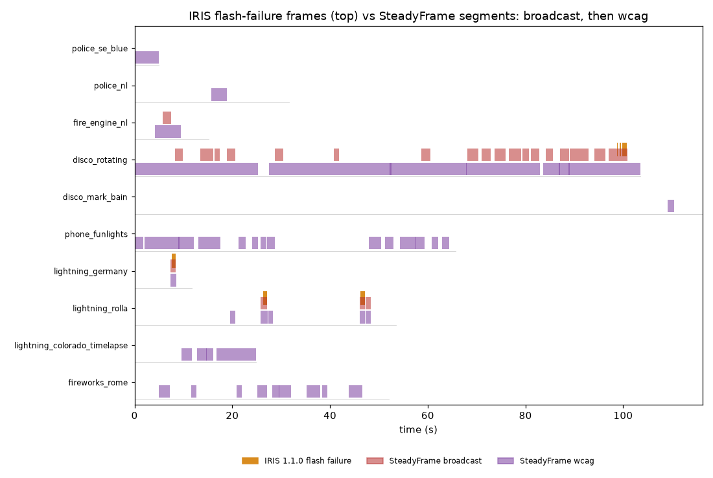

# Natural: real light sources against EA IRIS

Generated 2026-10-19 19:02 UTC by `python -m eval.natural` at git `eed9ea7`, steadyframe 0.1.0, **OpenCV 5.0.0** (arm64, CPython 3.11.15).

17 openly licensed Wikimedia Commons clips (10.0 minutes) of real things that flash. Labels: EA IRIS 1.1.0 (BSD-3-Clause, the official Ubuntu app), per frame, on the same H.264 transcode SteadyFrame reads; the app first reproduces IRIS's own expected logs on three of its test videos (`data/natural/iris_check.json`). Sources, licences, authors and checksums: `data/natural.yaml`. No label comes from this analyzer.

## Detection against IRIS

| profile | clip verdicts agree | IRIS fail frames inside a segment | per-second P / R / F1 | seconds flagged, IRIS pass |
|---|---|---|---|---|
| broadcast | 16/17 | 115/115 | 0.238 / 1.000 / 0.385 | 32/605 |
| wcag | 10/17 | 115/115 | 0.052 / 1.000 / 0.099 | 182/605 |

## Per clip

| clip | kind | video | IRIS | IRIS fail frames | broadcast | wcag | max cell rate (Hz) | max area over rate |
|---|---|---|---|---|---|---|---|---|
| police_se_blue | emergency | 320x240 25.0 fps 4.9 s | pass | 0 | pass | fail | 8.0 | 0.68 |
| police_memphis | emergency | 640x480 30.0 fps 3.0 s | pass | 0 | pass | pass | 6.5 | 0.02 |
| police_nl | emergency | 1920x1080 30.0 fps 31.6 s | pass | 0 | pass | fail | 9.0 | 0.64 |
| fire_engine_nl | emergency | 1920x1080 30.0 fps 15.2 s | pass | 0 | fail | fail | 9.5 | 0.91 |
| fire_berlin | emergency | 1920x1080 29.97 fps 7.3 s | pass | 0 | pass | pass | 6.0 | 0.17 |
| ambulance_toronto | emergency | 1280x720 30.0 fps 10.1 s | pass | 0 | pass | pass | 10.5 | 0.13 |
| disco_rotating | club | 640x480 30.0 fps 103.5 s | fail | 43 | fail | fail | 10.5 | 1.00 |
| disco_mark_bain | club | 720x576 24.97 fps 116.2 s | pass | 0 | pass | fail | 4.5 | 0.34 |
| phone_funlights | device | 480x320 25.0 fps 65.7 s | pass | 0 | pass | fail | 8.0 | 0.52 |
| neon_sign_komeda | signage | 996x1750 25.0 fps 12.2 s | pass | 0 | pass | pass | 1.5 | 0.00 |
| crossing_beacons | signage | 1920x1080 29.83 fps 13.1 s | pass | 0 | pass | pass | 2.5 | 0.00 |
| lightning_germany | lightning | 720x576 25.0 fps 11.7 s | fail | 19 | fail | fail | 6.5 | 1.00 |
| lightning_rolla | lightning | 1280x720 29.97 fps 53.5 s | fail | 53 | fail | fail | 7.5 | 1.00 |
| lightning_colorado_timelapse | lightning | 1920x1080 25.0 fps 24.8 s | pass | 0 | pass | fail | 11.5 | 0.47 |
| fireworks_rome | fireworks | 1080x606 29.57 fps 52.0 s | pass | 0 | pass | fail | 10.0 | 0.62 |
| fireworks_nagaoka | fireworks | 1280x720 25.0 fps 61.2 s | pass | 0 | pass | pass | 3.0 | 0.00 |
| xenon_flash_slowmo | flash | 784x152 4.83 fps 11.4 s | pass | 0 | pass | pass | 1.5 | 0.00 |

## Where they differ, and why

IRIS counts a transition when the *average* luminance of the area that changed moves by 0.10; SteadyFrame counts transitions in each cell of its 64x48 grid and then asks whether the cells over the rate cover a quarter of the screen. When some parts of the picture brighten while others darken (alternating emergency lights, moving disco spots), the changes cancel in an average and add up across cells. `net` below is |mean frame-to-frame change| / mean |cell change| on the analyzer's own grid: 1 means everything moves the same way, 0 that the changes cancel. `at once` is the largest share of the screen whose cells complete a transition within one frame of each other (`concurrency()` in this script).

| clip | IRIS / SteadyFrame (broadcast) | seconds only SteadyFrame flags | in SteadyFrame's segments: at once, median net | around IRIS's fail frames: at once, median net |
|---|---|---|---|---|
| fire_engine_nl | pass / fail | 2 | 0.44, 0.04 | -, - |
| disco_rotating | fail / fail | 30 | 1.00, 0.16 | 1.00, 0.33 |

Large areas change at the same moment in both tools' segments, so the difference is not about concurrency; it is the averaging. Where the changes are coherent IRIS fails the clip too. Where they cancel, IRIS's average stays under 0.10 and SteadyFrame's cells do not. Neither reading is a measurement of harm; SteadyFrame's is the stricter one, and it missed no frame IRIS failed.

## Repair, re-verified by SteadyFrame and by IRIS

| policy | clip | status | strategies | approvals | SSIM inside | SteadyFrame wcag / broadcast after | IRIS after |
|---|---|---|---|---|---|---|---|
| fixed | police_se_blue | passed | S1 | 0 | 0.485 | pass / pass | pass |
| fixed | police_nl | passed | S1 | 0 | 0.692 | pass / pass | pass |
| fixed | fire_engine_nl | passed | S1 | 1 | 0.499 | pass / pass | pass |
| fixed | disco_rotating | passed | S1,S1,S1,S1,S1,S1,S1,S1 | 2 | 0.772 | pass / pass | pass |
| fixed | disco_mark_bain | passed | S1 | 0 | 0.829 | pass / pass | pass |
| fixed | phone_funlights | passed | S1,S1,S1,S1,S1,S1,S1,S1,S1,S1,S1,S1,S1,S1 | 1 | 0.547 | pass / pass | pass |
| fixed | lightning_germany | passed | S1 | 1 | 0.272 | pass / pass | pass |
| fixed | lightning_rolla | passed | S1,S1,S1,S1,S1 | 2 | 0.625 | pass / pass | pass |
| fixed | lightning_colorado_timelapse | passed | S1,S1,S1,S1 | 0 | 0.949 | pass / pass | pass |
| fixed | fireworks_rome | passed | S1,S1,S1,S1,S1,S1,S1,S1,S1 | 0 | 0.661 | pass / pass | pass |
| heuristic | police_se_blue | passed | S1 | 0 | 0.490 | pass / pass | pass |
| heuristic | police_nl | passed | S1 | 0 | 0.694 | pass / pass | pass |
| heuristic | fire_engine_nl | passed | S4 | 1 | 0.505 | pass / pass | pass |
| heuristic | disco_rotating | passed | S4,S4,S4,S4,S4,S4,S4,S4 | 2 | 0.776 | pass / pass | pass |
| heuristic | disco_mark_bain | passed | S1 | 0 | 0.894 | pass / pass | pass |
| heuristic | phone_funlights | passed | S1,S1,S1,S1,S1,S1,S1,S1,S1,S4,S1,S1,S1,S1 | 2 | 0.558 | pass / pass | pass |
| heuristic | lightning_germany | passed | S4 | 1 | 0.335 | pass / pass | pass |
| heuristic | lightning_rolla | passed | S1,S4,S1,S4,S1 | 2 | 0.643 | pass / pass | pass |
| heuristic | lightning_colorado_timelapse | passed | S1,S1,S1,S1 | 0 | 0.960 | pass / pass | pass |
| heuristic | fireworks_rome | passed | S1,S1,S1,S1,S1,S1,S1,S1,S1 | 0 | 0.667 | pass / pass | pass |
